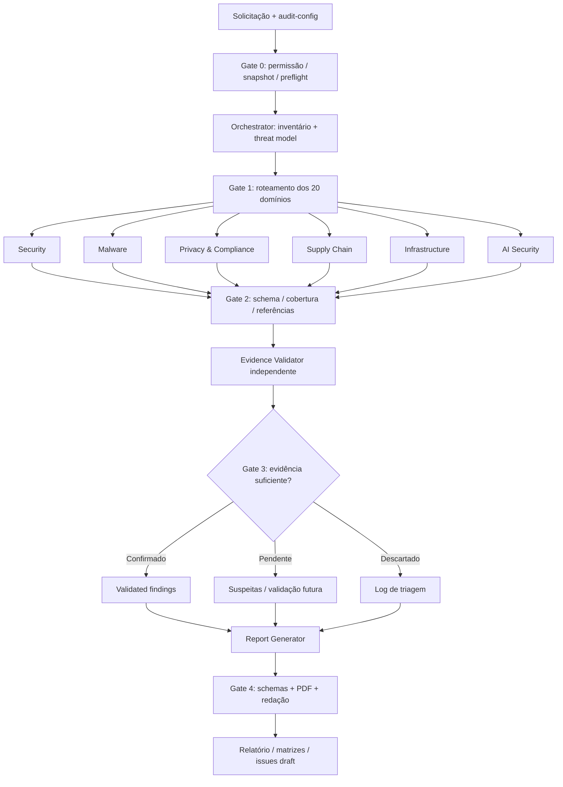

# Pipeline multiagente e contratos de passagem



## Máquina de estados

`PRE_FLIGHT -> DISCOVERY -> ANALYSIS -> VALIDATION -> REPORTING -> COMPLETED`.

Qualquer fase pode encerrar em `PARTIAL` com cobertura, bloqueios e checkpoint persistidos. Erros críticos de permissão, integridade do snapshot ou tentativa de execução não autorizada levam a `FAILED` sem prosseguir.

## Unidade de trabalho (task)

Uma task é `(run_id, scope_id, domain, agent, repository_revision)`. O orquestrador fornece identificador estável; especialistas recebem somente os componentes daquele escopo. Resultados devem ser imutáveis após entrega; a revisão do validador adiciona veredito em outro artefato.

```text
1. snapshot = read_only_target(revision)
2. inventory = discover_all_relevant_assets(snapshot)
3. plan = route(inventory, routing.yaml, applicability)
4. for task in plan: run_specialist_in_isolated_context(task)
5. verify_contracts_and_inventory_coverage(results)
6. candidates = deduplicate_preserving_evidence(results)
7. validated = independently_reopen_and_review(candidates, snapshot)
8. produce_reports_only_from(validated, inventory, compliance)
9. verify_generated_files_and_pdf_layout()
10. publish_paths_and_explicit_limitations()
```

Pseudocódigo é ilustrativo; não corresponde a runtime já implementado.

## Política de conflitos e duplicatas

- Mesmo root cause com múltiplos pontos vulneráveis: um finding com múltiplas evidências e links aos IDs originais.
- Achados contraditórios: reabrir as fontes e verificar controle compensatório; não escolher pelo voto de agentes.
- Especialista vs validator: validador pode rebaixar/rejeitar/promover com justificativa; não modifica evidência original.
- Dados pessoais, segredos e payloads: mascarar antes de transmitir entre agentes, preservando localizador seguro da evidência original.
- Runtime único sem contextos isolados: realizar triagem, mas **não** declarar revisão independente.

## Política de abrangência

Conte quantos itens aplicáveis foram descobertos e examinados por tipo de ativo, não por quantidade de arquivos lidos apenas. Para autorização, enumerar rotas/handlers/resolvers; para supply chain, manifests e locks; para IA, ferramentas e fluxos; para infra, manifests/serviços/ambientes. Registre incertezas de descoberta, itens indisponíveis e exclusões. Não afirmar 100% quando o denominador não é confiável.
